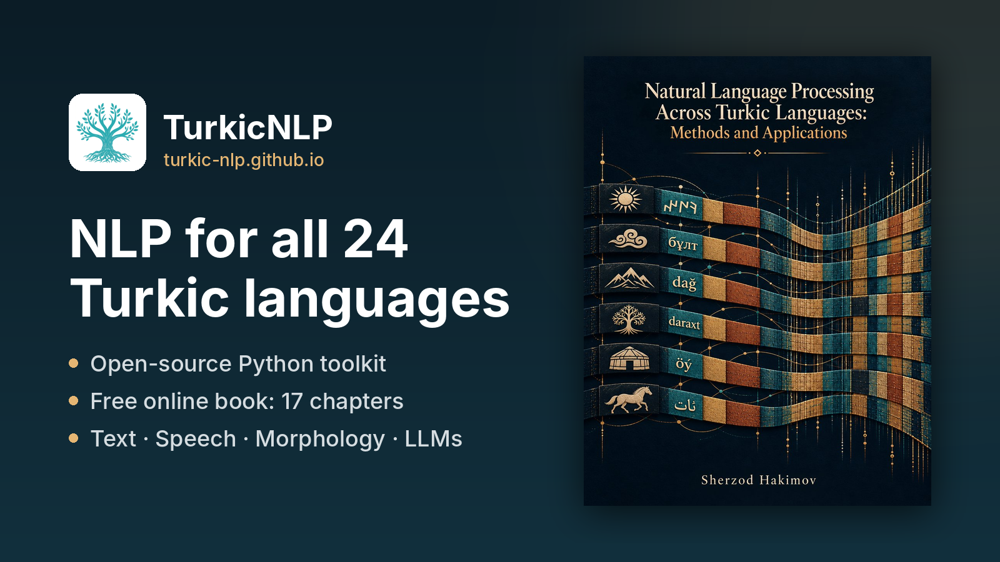

Turkic languages are spoken from the Balkans and Anatolia to Central Asia, western China and north-eastern Siberia. They share much of their grammar, yet the tools available for them range from production-ready for Turkish to almost nothing for Khakas or Tuvan. They're written in Latin, Cyrillic and Perso-Arabic scripts, sometimes all three for a single language.

Over the past months I've been working on two things to close that gap: **an open-source toolkit** and **a free online book**. Both are out now.



## 🔧 The toolkit: TurkicNLP

**[TurkicNLP](https://turkic-nlp.github.io/toolkit/)** is a pip-installable Python library with one Stanza-style pipeline for the whole family. It currently has:

- **24 languages** across the Oghuz, Kipchak, Karluk, Siberian, Oghur and Arghu branches, plus Ottoman Turkish and Old Turkic
- **15 pipeline processors**: tokenization, morphology, POS tagging, lemmatization, dependency parsing, NER, translation, embeddings, sentiment, spelling correction, subword tokenization and speech recognition
- **7 backend families** combined behind one interface: rule-based, Apertium finite-state transducers (20 languages), Stanza/UD models (9 languages, 5 of them custom-trained), multilingual Glot500 models (POS/parsing for 15 languages, morphology for 22), NLLB-200 translation and embeddings (11 languages), Omnilingual ASR and LLMs
- **Speech → text → analysis** for 20 Turkic languages, with transcripts returned in each language's own script
- **An LLM backend for all 24 languages.** Morphology, NER, translation, sentiment and spelling correction can run on a local vLLM/Ollama model, OpenAI, Claude or a Hugging Face model. Answers are validated against the toolkit's tokens, so a failed answer stays empty rather than being guessed.
- **A hybrid morpheme tokenizer** that combines FSTs with neural models and segments **89%** of words exactly across 20 languages (Apertium alone: 79%, neural alone: 68%)
- **Script handling built in**: transliteration between Cyrillic, Latin and Perso-Arabic, the Common Turkic Alphabet for 23 languages, and Old Turkic runes. Text in a script without models (e.g. Uzbek Cyrillic) is transliterated automatically and the results are mapped back.

```bash
pip install "turkicnlp[all]"
```

```python
import turkicnlp

nlp = turkicnlp.Pipeline("kaz", processors=["tokenize", "pos", "lemma", "depparse"])
doc = nlp("Мен мектепке бардым.")
print(doc.to_conllu())
```

The library is Apache 2.0. Apertium data is GPL and downloaded separately, so the package stays permissively licensed.

## 📖 The book: *Natural Language Processing Across Turkic Languages*

The toolkit answers *how* to run things. The **[book](https://turkic-nlp.github.io/textbook/)** explains *why* they work, where they fail, and what to build next. It's free to read online, licensed CC BY-SA 4.0, with a DOI on [Zenodo](https://doi.org/10.5281/zenodo.23324599).

**17 chapters + 4 appendices**, built around three recurring questions: *How does morphology affect a task? What changes when the script changes? What transfers between related languages?*

- **The language family:** [the Turkic world and its resource reality](https://turkic-nlp.github.io/book/chapters/01-turkic-world.html), and [the computational phenotype](https://turkic-nlp.github.io/book/chapters/02-computational-phenotype.html) of Turkic languages
- **Writing systems & corpora:** [scripts and orthographic engineering](https://turkic-nlp.github.io/book/chapters/03-scripts-orthography.html), [building corpora at scale](https://turkic-nlp.github.io/book/chapters/04-corpora-at-scale.html)
- **Morphology:** [linguistic foundations](https://turkic-nlp.github.io/book/chapters/05-morphological-structure.html), [finite-state](https://turkic-nlp.github.io/book/chapters/06-finite-state-morphology.html) and [neural morphology & tokenisation](https://turkic-nlp.github.io/book/chapters/07-neural-morphology.html)
- **Syntax & applications:** [Universal Dependencies](https://turkic-nlp.github.io/book/chapters/08-syntax-ud.html), [POS/NER](https://turkic-nlp.github.io/book/chapters/09-sequence-labeling.html), [machine translation](https://turkic-nlp.github.io/book/chapters/10-machine-translation.html), [speech](https://turkic-nlp.github.io/book/chapters/11-speech-technologies.html)
- **Language models:** [pretrained LMs](https://turkic-nlp.github.io/book/chapters/12-pretrained-lms.html), [embeddings & retrieval](https://turkic-nlp.github.io/book/chapters/13-meaning-retrieval.html), [generation & dialogue](https://turkic-nlp.github.io/book/chapters/14-generation-dialogue.html), [evaluation & benchmarks](https://turkic-nlp.github.io/book/chapters/15-evaluation-benchmarks.html)
- **The resource frontier:** [cross-lingual transfer](https://turkic-nlp.github.io/book/chapters/16-cross-lingual-transfer.html), [endangered languages & ethics](https://turkic-nlp.github.io/book/chapters/17-endangered-ethics.html)

Every chapter has exercises, and most have a hands-on section that uses the toolkit, so you can reproduce what you read.

## 🤝 How you can help

This is a community effort, and the most valuable contributions don't require writing code:

- **Speakers:** check analyses in your language. Native speakers catch wrong lemmas and segmentations that no metric does.
- **Readers:** found a mistake in the book? Please open a pull request on [github.com/turkic-nlp/book](https://github.com/turkic-nlp/book).
- **Researchers & developers:** the [roadmap](https://github.com/turkic-nlp/turkicnlp/blob/main/ROADMAP.md) lists open tasks, and items marked **S** are good first issues.
- **Everyone:** star the repo, share it with someone working on a Turkic language, or join us on [Discord](https://discord.gg/CeVTbGpmMQ).

---

**Website:** [turkic-nlp.github.io](https://turkic-nlp.github.io/)

**Toolkit:** [github.com/turkic-nlp/turkicnlp](https://github.com/turkic-nlp/turkicnlp) · [PyPI](https://pypi.org/project/turkicnlp/) · [Notebooks](https://github.com/turkic-nlp/turkic-nlp-code-samples) · [🤗 Models & data](https://huggingface.co/turkicnlp)

**Book:** [Read online](https://turkic-nlp.github.io/book/preface.html) · [Table of contents](https://turkic-nlp.github.io/textbook/) · [Source](https://github.com/turkic-nlp/book) · [DOI 10.5281/zenodo.23324599](https://doi.org/10.5281/zenodo.23324599)

**Paper:** [TurkicNLP: An NLP Toolkit for Turkic Languages (arXiv:2602.19174)](https://arxiv.org/abs/2602.19174)
